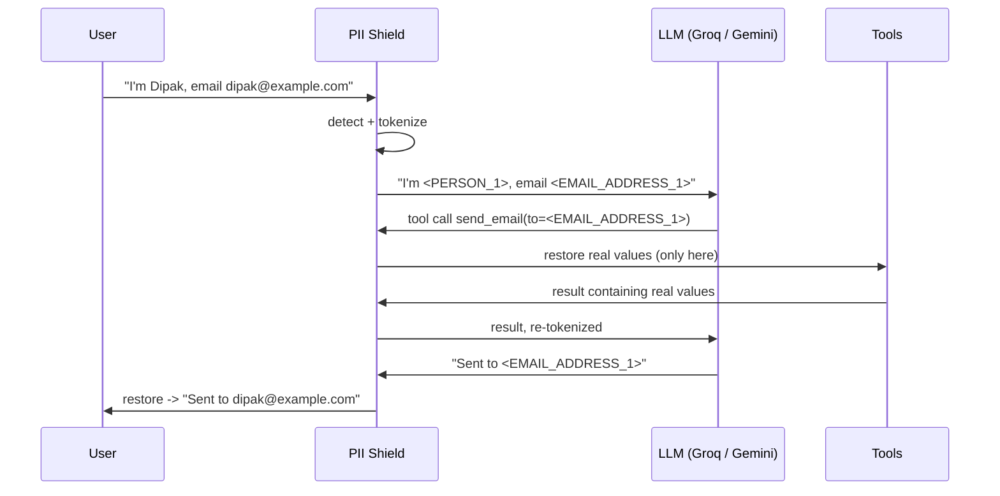

# PII Shield

Privacy-preserving middleware for LLM applications. **The model never sees raw personal data.**

PII Shield sits between your app and an LLM provider. It replaces names, emails, phone numbers and similar data with placeholder tokens before anything leaves your server. The model reasons and calls tools using only those tokens, and real values come back only at the last moment, when a tool actually executes or when the final answer is shown to the user.

[](https://github.com/dipak-shaaki/[TODO-repo-name]/actions/workflows/ci.yml)

## The problem

Chatbots, RAG assistants and support agents receive personal data in free text, and by default all of it is forwarded to a third-party LLM provider. For regulated domains (banking, healthcare) that is a compliance risk, and most RAG tutorials ignore it.

## How it works



Five points are guarded, not two:

1. **User input** is detected and tokenized before the LLM sees it. Credit card numbers are hard-blocked instead of tokenized.
2. **Tool-call arguments** from the LLM are re-scanned, so persisted history never holds real values.
3. **Tool execution** is the only place tokens are restored. Placeholders the model invented (`<EMAIL_ADDRESS_9>`) stop the call and the model gets an error back.
4. **Tool results** contain real values, so they are re-tokenized before going back to the model.
5. **The final reply** is scanned for leaks, then restored for display.

Two queries come out of every message: `llm_query` (fully tokenized, the only version a provider may see) and `rag_query` (names restored, for local retrieval only).

## Features

- Detection with Microsoft Presidio plus a custom phone recognizer built on Google's `libphonenumber` (strict validation, multiple regions)
- Per-session token vault with token reuse (the same person is always `<PERSON_1>`)
- Fail-closed design: if detection or storage fails, the request fails. Raw text is never passed through
- Provider-agnostic LLM layer: Groq primary, Gemini fallback. Transient errors (rate limit, timeout, 5xx) fall back, while permanent errors (bad key) fail loudly
- LangGraph agent with PII-safe tool calling
- Redis sessions: vault encrypted with Fernet (key rotation supported), sliding TTL, per-session locking
- FastAPI service with Pydantic schemas and typed error handling
- Evaluation suite with labeled data (precision, recall, latency)
- Multi-stage non-root Docker image and a GitHub Actions pipeline

## Quickstart

Requirements: Python 3.11, [uv](https://docs.astral.sh/uv/), Redis.

```bash
git clone https://github.com/dipak-shaaki/[TODO-repo-name].git
cd [TODO-repo-name]
uv sync
cp .env.example .env
# add GROQ_API_KEY and GEMINI_API_KEY, then generate an encryption key:
uv run python -c "from cryptography.fernet import Fernet; print(Fernet.generate_key().decode())"
# paste it as ENCRYPTION_KEY in .env

redis-cli ping    # expect PONG
uv run uvicorn pii_shield.api.main:app
```

Open `http://localhost:8000/docs` for interactive API docs.

With Docker (starts Redis too):

```bash
docker compose up --build
```

## Using it as a library

```python
from pii_shield import PIIShield, TokenVault

shield = PIIShield.from_settings()
vault = TokenVault()  # one per conversation

safe = shield.sanitize("Hi, I'm Dipak Shanki, call me on 9841657581", vault)
safe.llm_query   # "Hi, I'm <PERSON_1>, call me on <PHONE_NUMBER_1>"  -> send this to your LLM

reply = shield.sanitize_output(llm_text, vault).text  # re-scan the model's answer
shield.restore(reply, vault)                          # real values, for the user or a tool
```

`sanitize` raises `InputBlockedError` for card numbers and `DetectionError` if detection fails. Both are raised before anything is stored.

## API

| Method | Path | Purpose |
|---|---|---|
| POST | `/chat` | Send a message. Returns `reply` (what the user sees), `llm_query` (what the LLM saw), `llm_reply`, tool trace, `session_id` |
| GET | `/sessions/{id}` | Stored history (tokens only) |
| DELETE | `/sessions/{id}` | Delete a session |
| GET | `/health` | Liveness, plus Redis status (503 if Redis is down) |

```bash
curl -s localhost:8000/chat -H 'content-type: application/json' \
  -d '{"message":"Hi, I am Dipak Shanki, email dipak@example.com"}'
```

A blocked message (credit card) returns HTTP 200 with `"blocked": true`, since that is the guardrail working, not a server error.

## Configuration

| Variable | Default | Purpose |
|---|---|---|
| `GROQ_API_KEY` | required (API) | Primary LLM provider |
| `GEMINI_API_KEY` | required (API) | Fallback provider |
| `ENCRYPTION_KEY` | required (API) | Fernet key(s), comma-separated. First encrypts, all decrypt (rotation) |
| `REDIS_URL` | `redis://localhost:6379/0` | Session storage |
| `SPACY_MODEL` | `en_core_web_lg` | NER model (`sm` / `md` / `lg`) |
| `PII_CONFIDENCE_THRESHOLD` | `0.4` | Minimum detection score |
| `SESSION_TTL_SECONDS` | `3600` | Sliding session expiry |
| `AGENT_MAX_TOOL_ROUNDS` | `5` | Cap on tool-calling loops |
| `EXPOSE_TOKEN_MAP` | `false` | Demo only. Returns real values in API responses |
| `LOG_LEVEL` | `INFO` | Logging verbosity |

## Evaluation

Run on `[TODO: N]` labeled sentences (names, emails, phones from several regions, credit cards, and negatives that should *not* be flagged):

```bash
uv run python -m pii_shield.evaluation --models en_core_web_sm en_core_web_md en_core_web_lg
```

Results with `[TODO: model]`, threshold `[TODO]`:

| Entity | Precision | Recall | F1 |
|---|---|---|---|
| PERSON | [TODO] | [TODO] | [TODO] |
| EMAIL_ADDRESS | [TODO] | [TODO] | [TODO] |
| PHONE_NUMBER | [TODO] | [TODO] | [TODO] |
| CREDIT_CARD | [TODO] | [TODO] | [TODO] |

Model trade-off:

| spaCy model | Micro recall | Median latency / message | Image size | Idle RAM |
|---|---|---|---|---|
| `en_core_web_sm` | [TODO] | [TODO] ms | [TODO] | [TODO] |
| `en_core_web_md` | [TODO] | [TODO] ms | [TODO] | [TODO] |
| `en_core_web_lg` | [TODO] | [TODO] ms | n/a | n/a |

Recall is weighted over precision, because a missed span is a leak while a false positive only costs usability. `[TODO: one sentence on why you chose the shipped model.]`

## Project structure

```
src/pii_shield/
├── core/         detector, recognizers, tokenizer, vault, guardrails
├── pipeline.py   PIIShield facade: sanitize / sanitize_output / restore
├── providers/    LLM interface, Groq, Gemini, fallback
├── agent/        LangGraph agent and tool registry
├── storage/      encrypted Redis session store
├── api/          FastAPI routes, schemas, error handlers
└── evaluation/   labeled-data scoring
tests/            pytest suite (real Redis tests skip if Redis is down)
eval/             labeled dataset
```

## Design decisions

- **Fail closed.** An empty detection result would mean "no PII", so detector errors raise instead of returning `[]`.
- **Detect once per message.** The input guard and the tokenizer share one scan, because spaCy is the slow part.
- **Sessions replace globals.** The prototype used global state. Each session now has its own vault, serialized to Redis.
- **Never log values.** Logs and error messages carry entity types and counts only. A PII tool that logs PII defeats itself.
- **Save only on success.** A failed turn leaves the stored session untouched, so a retry is clean.
- **Locking.** Load, run, save is a read-modify-write, so each session is locked to stop concurrent requests overwriting each other's tokens.
- **Dependency inversion.** The tokenizer depends on a `detect()` protocol rather than Presidio, so tests run without loading spaCy.

## Security model and limitations

What it protects: raw PII reaching the LLM provider, PII sitting in stored history, and PII readable in Redis without the key.

What it does not guarantee:

- **Detection is probabilistic.** Anything the NER model misses is sent to the provider. See the recall numbers above. Lowercase or unusual names are the weak spot.
- **Context can still reveal things.** The provider sees the surrounding text, only not the tokenized values.
- **English only.** The pipeline is configured for English.
- **Tool code is trusted.** Tools receive real values by design.
- **No authentication or rate limiting in v0.1.0.** Session ids are unguessable bearer values, but anyone with the URL can call `/chat`. Do not expose a deployment publicly without adding both. `[TODO: update if you add rate limiting before tagging]`
- **`EXPOSE_TOKEN_MAP`** returns real values in responses. It is for demos only and is off by default.
- **Latency.** Each turn runs NER on the input, on each model message and on tool results.
- The bundled tools are stubs that show the flow and do not send real email.

## Development

```bash
uv run pytest -v           # tests (start Redis for the storage tests)
uv run ruff check .
uv run ruff format .
```

Git flow: feature branches, then PRs into `dev`, then `dev` into `main`. CI runs lint, tests (including real Redis) and a Docker build with a boot smoke test. Merges to `main` publish the image to GHCR.

## Roadmap

- Demo web UI showing the raw input, the tokenized text the LLM saw, and the final reply side by side
- Rate limiting and authentication
- Streaming responses with mid-stream tokenization
- Publish the core engine to PyPI

## License

MIT